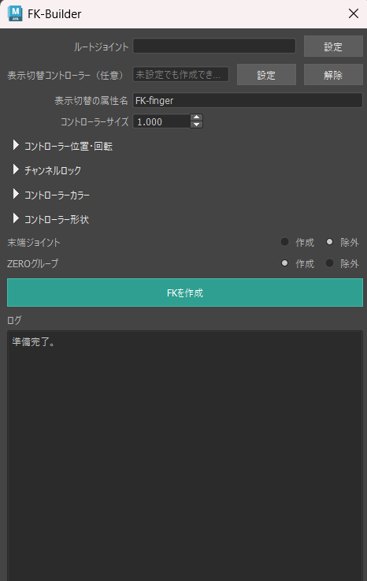
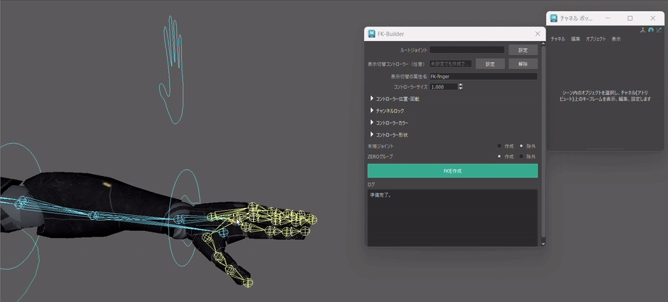
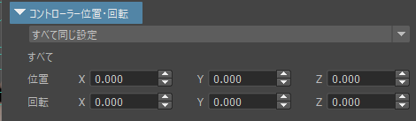
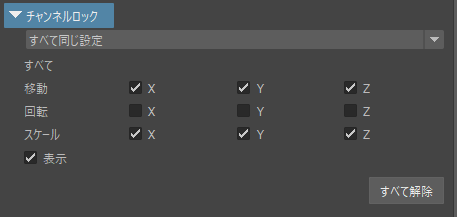
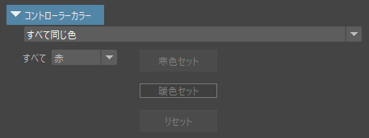
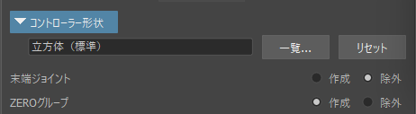
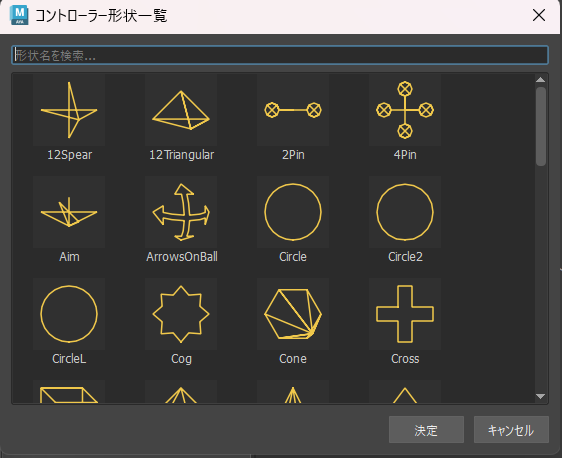

# FK Builder

[](https://github.com/Yuzuki-Midoshima/FK-Builder/actions/workflows/ci.yml)




Autodesk Maya向けの、**ジョイント階層からFKコントローラーリグを自動構築するリギングツール**です。

コントローラーの作成、位置合わせ、階層化、コンストレイント設定、シェイプ、カラー、Channel Lockなど、FKリグ構築時に繰り返し発生する作業を、ひとつのUIからまとめて設定・実行できます。

手作業による設定漏れや命名ミスを減らしながら、**素早く、一貫した構造のFKリグを構築すること**を目的として開発しました。

---

## 主な機能

- **FKリグの自動構築**  
  選択したルートジョイント以下の階層を解析し、ジョイント構造に対応したFKコントローラーリグを自動構築します。

- **コントローラーの調整**  
  コントローラーの位置、回転、Channel Lock、カラー、シェイプを構築前に設定できます。

- **柔軟な出力構造**  
  末端ジョイントへのコントローラー生成やZERO Groupの有無を選択でき、用途に合わせて生成する階層構造を変更できます。

- **表示切替管理**  
  任意のコントローラーへ表示切替用Attributeを追加し、生成したFKコントローラー群の表示・非表示をまとめて管理できます。

- **シェイプライブラリ**  
  複数のコントローラーシェイプから、用途に合った形状を選択できます。

- **事前検証 / ロールバック**  
  構築前に必要なノードや設定を検証し、途中で問題が発生した場合もシーンへの影響を抑えます。

- **再利用可能なワークフロー**  
  特定のキャラクター専用ではなく、異なるジョイントチェーンへ繰り返し利用できるFK Builderとして設計しています。

---

## 概要

FKコントローラーリグを手作業で構築する場合、

**コントローラー作成 → ジョイントへの位置合わせ → シェイプ調整 → ZERO Group作成 → 階層化 → コンストレイント設定 → カラー設定 → Channel Lock**

といった定型作業をジョイントごとに繰り返す必要があります。

ジョイント数が増えるほど作業量が増えるだけでなく、命名、階層構造、コンストレイント、Channel設定などの細かな設定漏れも発生しやすくなります。

FK Builderではルートジョイントを指定すると、そのジョイント以下の階層を解析し、必要なコントローラーを親から子へ自動構築します。

```text
ジョイント階層
      ↓
階層解析
      ↓
構築設定
      ↓
コントローラー生成
      ↓
FK階層構築
      ↓
コンストレイント設定
      ↓
最終検証
```

単純にコントローラーを大量生成するのではなく、**構築前に見た目・操作方法・出力構造をまとめて指定し、一貫したFKリグとして出力できること**を重視しています。

### 動作例



---

## 機能詳細

### FKリグの自動構築

ルートジョイントを指定すると、そのジョイント以下の階層を解析し、対応するコントローラーを自動生成します。

ジョイント階層に合わせてコントローラー側にもFK階層を構築するため、構築後すぐに通常のFKコントローラーとして操作できます。

繰り返し発生するコントローラー作成や階層設定をまとめて処理することで、手作業による設定差を減らします。

```text
ルートジョイント
   │
   ├─ ジョイント
   │   └─ ジョイント
   │
   └─ ジョイント

        ↓

FKコントローラー
   │
   ├─ FKコントローラー
   │   └─ FKコントローラー
   │
   └─ FKコントローラー
```

---

### コントローラーの位置 / 回転

コントローラーの位置と回転を、構築前に調整できます。



ジョイントへコントローラーを配置したあとに一つずつシェイプを修正するのではなく、生成前の設定として調整できるため、構築後の手直しを減らせます。

コントローラーの見た目を調整する処理と、実際にアニメーションで使用するTransformをできるだけ分離し、扱いやすいコントローラーを生成することを意識しています。

---

### Channel Lock

コントローラーごとに、不要なTransform ChannelをLockできます。



例えば回転のみを使用するFKコントローラーでは、不要なTranslate / Scale Channelを制限することで誤操作を防止できます。

単にコントローラーを生成するだけではなく、**アニメーターがどのChannelを操作すればよいか分かりやすい状態まで構築すること**を目的としています。

---

### コントローラーカラー

コントローラーのカラーを構築前に設定できます。



左右や部位ごとにコントローラーの色を分けることで、Viewport上での視認性を高められます。

コントローラー生成後に一つずつ色を設定する必要がなく、構築時点で見た目のルールを統一できます。

---

### コントローラーシェイプ

用途に合わせてコントローラーシェイプを選択できます。





コントローラーの役割に応じてシェイプを変更できるため、単一の形状だけでFKリグを構築するのではなく、操作性や視認性を考慮したコントローラー構成にできます。

シェイプデータとFK構築処理を分離することで、シェイプライブラリを追加・変更しやすい構造にしています。

---

### 末端ジョイントの生成設定

ジョイントチェーンの末端ジョイントにコントローラーを生成するかどうかを選択できます。

```text
作成する場合

ジョイント
└─ ジョイント
   └─ 末端ジョイント
      └─ コントローラー


除外する場合

ジョイント
└─ ジョイント
   └─ 末端ジョイント
```

末端ジョイントまで直接操作したい場合は作成し、末端ジョイントを構造上の終端としてのみ使用する場合は除外できます。

リグの用途によって必要なコントローラー構成が異なるため、固定仕様にせず選択可能にしています。

---

### ZERO Groupの生成設定

コントローラー生成時に、各コントローラーへZERO Groupを作成するかどうかを選択できます。

```text
作成する場合

Controller_ZERO
└─ Controller


除外する場合

Controller
```

ZERO Groupを使用する場合は、コントローラーの初期Transformを保持したままOffset階層として利用できます。

一方で、既存リグへ追加する場合や、必要以上に階層を増やしたくない場合にはZERO Groupを除外できます。

特定のリグ構造をツール側から強制するのではなく、**用途や既存階層に合わせて出力構造を選択できること**を重視しています。

---

### 表示切替管理

任意のコントローラーを表示切替用コントローラーとして指定できます。

指定したコントローラーへVisibility Attributeを追加し、生成したFKコントローラー群の表示・非表示をまとめて管理します。

Attribute名もUIから設定できるため、

```text
Settings_CTRL
└─ FK-finger
```

のように、リグの用途に合わせた表示管理ができます。

FKコントローラーごとに表示設定を行う必要がなく、リグ全体の操作を一か所へ集約できます。

---

## 使用手順

基本的なFKリグの構築は、以下の流れで行います。

1. FK化したい階層の**ルートジョイント**を選択
2. `設定`からルートジョイントを登録
3. 必要に応じて表示切替用コントローラーを設定
4. コントローラーサイズを調整
5. 位置 / 回転を設定
6. Channel Lockを設定
7. コントローラーカラーを設定
8. コントローラーシェイプを選択
9. 末端ジョイントを**作成 / 除外**から選択
10. ZERO Groupを**作成 / 除外**から選択
11. `FKを作成`を実行
12. Logから構築結果を確認

```text
ルートジョイントを選択
          ↓
コントローラー設定
          ↓
出力構造を設定
          ↓
FKを作成
          ↓
自動検証
          ↓
アニメーション作業へ
```

ジョイントごとにコントローラーを作成して設定するのではなく、**構築前に必要な情報をまとめて指定し、一度の実行でFKリグを完成させる**ワークフローにしています。

### 一連の操作

---

## 設計方針

### FKリグ構築の効率化

FKリグの構築では、高度な処理だけでなく「同じ操作を何度も繰り返すこと」も大きな作業負担になります。

コントローラー作成、位置合わせ、階層化、コンストレイント設定、カラー、Channel Lockなどの定型作業をまとめて自動化することで、リガーがコントローラーの操作性やリグ全体の設計など、より重要な調整へ時間を使えることを目指しています。

---

### アニメーターが扱いやすい構成

自動生成されたコントローラーを、そのままアニメーション作業へ使用しやすい状態にすることを意識しています。

- 不要ChannelのLock
- コントローラーカラーによる視認性向上
- 用途に応じたコントローラーシェイプ
- Visibilityの一括管理
- 予測しやすいFK階層

など、リグを「構築できること」だけでなく、**構築後に扱いやすいこと**も設計対象としています。

---

### 柔軟な出力構造

リグの構造は制作環境や用途によって異なるため、生成する階層をひとつの形式へ固定していません。

末端ジョイントへのコントローラー生成やZERO Groupの有無を選択可能にすることで、

- 新規リグの構築
- 既存リグへの追加
- シンプルなFKチェーン
- Offset階層を必要とするリグ

など、それぞれのワークフローに合わせた出力ができます。

**自動化によって制作側へ構造を強制するのではなく、必要な部分だけを自動化できる柔軟性**を意識しています。

---

### 構造を追いやすい設計

自動化によってリグ内部をブラックボックス化しないことも重視しています。

ジョイント階層を基準としてコントローラー階層を構築し、生成されるコントローラー / ZERO Group / コンストレイントの関係を追いやすい構造にしています。

構築後に手作業で調整したい場合でも、どのノードが何のために存在しているのか把握しやすい状態を目指しています。

---

### 再利用性

特定のキャラクター専用の処理としてではなく、ルートジョイントを起点として異なるジョイントチェーンへ使用できる構造にしています。

キャラクターごとに同じFK構築スクリプトを書き直すのではなく、設定を変更することで同じBuilderを再利用できることを重視しています。

---

## 内部構成

処理をUIへ集中させず、役割ごとにモジュールを分離しています。

```text
                  FK Builder
                      │
              ┌───────┴───────┐
              │               │
              UI            構築設定
              │               │
              └───────┬───────┘
                      ▼
                   Builder
                      │
          ┌───────────┼───────────┐
          │           │           │
        階層解析  コントローラー  シェイプデータ
          │           │           │
          └───────────┼───────────┘
                      ▼
                  Mayaシーン
```

### UI

ユーザーから、

- ルートジョイント
- Visibility
- コントローラーサイズ
- 位置 / 回転
- Channel Lock
- カラー
- シェイプ
- 末端ジョイント
- ZERO Group

などの構築設定を受け取ります。

### Builder

事前検証からコントローラー生成、階層構築、コンストレイント設定、最終確認まで、FKリグ構築全体を管理します。

### 階層解析

ルートジョイント以下のジョイント構造を解析し、親子関係に対応したFKコントローラー階層を構築します。

### コントローラー

NURBS Curve Controllerの生成やシェイプ処理、Transform関連の処理を担当します。

### シェイプデータ

コントローラーシェイプの定義をFK構築処理から分離し、シェイプの追加・変更を行いやすくしています。

---

## 事前検証 / 安全性

FK Builderでは既存のジョイント階層へ処理を行うため、シーンを不用意に変更しないことを重視しています。

構築前に必要な情報を確認し、問題がある場合は処理を開始しません。

主な確認対象は、

- ルートジョイント
- ジョイント階層
- コントローラー名
- 既存ノード
- シェイプデータ
- Visibility用コントローラー
- Visibility Attribute
- 構築設定

などです。

また、構築処理をひとつのUndo単位として扱い、途中でエラーが発生した場合にシーンへ不完全なリグが残ることをできるだけ防ぎます。

自動化による速度だけでなく、**既存シーンに対して安心して実行できること**を重要な要件としています。

---

## テスト

Mayaに依存しない処理については、可能な範囲でMayaのシーン操作から分離し、テストできる構造にしています。

主なテスト対象は、

- 命名処理
- 選択状態の検証
- ジョイント階層
- コントローラー設定
- シェイプデータ
- カラー設定
- Visibility Attribute
- 分岐処理

などです。

GitHub Actionsでは、Push / Pull Request時に自動テストを実行します。

```text
Push / Pull Request
        ↓
構文チェック
        ↓
Unit Tests
        ↓
Import Check
        ↓
Result
```

コード変更によって既存機能へRegressionが発生していないか確認し、継続的に修正・機能追加を行いやすい状態を維持します。

---

## 技術情報

- Autodesk Maya 2026
- Python 3
- maya.cmds
- PySide6
- shiboken6
- JSON
- unittest
- GitHub Actions

### 技術的なポイント

- ジョイント階層の自動解析
- ジョイント構造に対応したFK階層生成
- コントローラーシェイプデータの分離
- コントローラー位置 / 回転調整
- 末端ジョイントへの選択的なコントローラー生成
- ZERO Groupの選択的生成
- Visibility Attributeの自動構築
- Channel Lockの自動設定
- 構築前の検証
- Undo / Rollbackを考慮したシーン操作

---

## 動作環境

- Autodesk Maya 2026（動作確認済み）
- Python 3
- PySide6 / shiboken6

現在はMaya 2026で開発・動作確認を行っています。

その他のMayaバージョンおよびOS環境については未検証です。

PySide6 / shiboken6はMaya 2026に同梱されているものを使用します。

外部Pythonパッケージは必要ありません。

---

## インストール

リポジトリをMayaからアクセス可能な場所へCloneまたはDownloadします。

例：

```text
Documents/
└─ maya/
   └─ scripts/
      └─ FK-Builder/
```

Maya Script EditorのPythonタブからLauncherを実行します。

```python
from pathlib import Path
import runpy
from maya import cmds

tool_root = Path(cmds.internalVar(userScriptDir=True)) / "FK-Builder"
runpy.run_path(str(tool_root / "launch_fk_builder.py"))
```

---

## プロジェクト構成

```text
FK-Builder/
│
├─ fk_builder/
│  ├─ main.py
│  ├─ ui.py
│  ├─ builder.py
│  ├─ controller.py
│  ├─ hierarchy.py
│  ├─ shape_library.py
│  ├─ shape_picker.py
│  ├─ utils.py
│  │
│  └─ data/
│     └─ bundled_shapes.json
│
├─ tests/
│
├─ docs/
│  ├─ images/
│  └─ gifs/
│
├─ .github/
│  └─ workflows/
│
├─ launch_fk_builder.py
└─ README.md
```

各モジュールの役割を分離することで、UI変更、コントローラー生成処理、階層解析、シェイプ追加などの変更が互いに影響しにくい構造を意識しています。

---

## 現在の対応範囲

現在のFK Builderは、**ジョイント階層からFKコントローラーリグを構築すること**に機能を絞っています。

### 対応している機能

- ルートジョイント以下のFKリグ生成
- ジョイント階層の自動解析
- 分岐を含むジョイント階層
- コントローラー位置 / 回転設定
- Channel Lock
- コントローラーカラー
- コントローラーシェイプ
- 末端ジョイントの作成 / 除外
- ZERO Groupの作成 / 除外
- Visibility Attribute
- FKコントローラー階層生成

### 現在の対象外

- IKリグの自動構築
- FK / IK Switchの生成
- Skinning / Weight処理
- Maya 2026以外の環境での動作保証

FK Builder単体ですべてのリグを自動生成するのではなく、**FKコントローラーリグを素早く、一貫性のある構造で構築すること**を現在の役割としています。

---

## 制作背景

FKリグを制作する中で、コントローラー作成そのものより、

- ジョイントへの位置合わせ
- コントローラーシェイプの調整
- ZERO Group作成
- 命名
- コントローラーの階層化
- コンストレイント設定
- カラー設定
- Channel Lock
- Visibility設定

といった定型作業を何度も繰り返すことに、制作時間を取られることが課題でした。

```text
制作上の課題
      ↓
FKセットアップの反復
      ↓
自動化を試作
      ↓
コントローラー調整機能
      ↓
階層構造の選択
      ↓
事前検証
      ↓
再利用可能なFK Builder
```

そこで、単純なコントローラー自動生成スクリプトではなく、**見た目・操作性・階層構造・安全性まで含めて、FKリグ構築をひとつのワークフローとして扱えるツール**として開発しました。

また、自動化する範囲を固定するのではなく、末端ジョイントやZERO Groupの生成を選択できるようにすることで、異なるリグ構造や制作方針にも対応できる設計にしています。

手作業をすべて置き換えることではなく、**繰り返し作業を自動化しながら、リガーが必要な構造を選択できること**を目指しています。

---

## License

MIT License

Copyright (c) 2026 Yuzuki Midoshima
